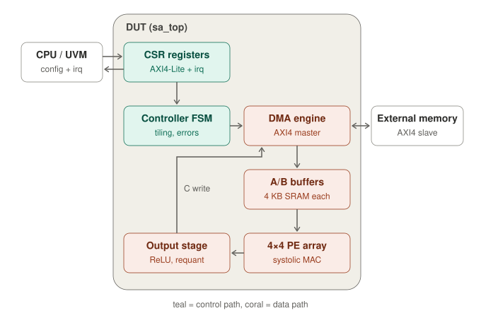

# SA-GEMM: Systolic-Array INT8 GEMM Accelerator Verification

INT8 matrix-multiply accelerator (AXI4-Lite CSR + AXI4 DMA master + N×N output-stationary
PE array + requantization) verified with a UVM environment on Cadence Xcelium.

## Roles
- **Verification (UVM environment, verification plan, coverage, regression):** Seungyun Lee
- **DUT RTL:** written with an AI assistant from the spec in `docs/spec.md`, then treated as
  a third-party design under test.

## Architecture
<p align="center">
  
</p>

1. The CPU (the UVM AXI4-Lite agent in simulation) programs the CSR block and writes `CTRL.START`.
2. The controller has the DMA engine fetch A and B from external memory over AXI4
   (up to 4 outstanding read bursts, out-of-order / interleaved responses).
3. The 4×4 output-stationary systolic array computes each output tile from the A/B buffers.
4. The output stage applies ReLU and optional INT8 requantization; the DMA engine writes C back.
5. On completion or error the CSR block raises `irq`.

Full details are in [`docs/spec.md`](docs/spec.md).

## Layout
| Path            | Contents |
|-----------------|----------|
| `docs/spec.md`  | Design specification (DUT contract) |
| `docs/vplan.md` | Verification plan |
| `docs/ko/`      | Korean translations of the spec and the verification plan (the English files are authoritative) |
| `rtl/`          | DUT RTL |
| `tb/smoke/`     | Designer smoke tests |
| `docs/bug_log.md` | RTL bugs found by verification |
| `sim/`          | Simulation run directory (outputs are git-ignored) |
| `formal/`       | SymbiYosys proofs (properties, `.sby` scripts, mutant check) |
| `sync.sh`       | Copies the repo to the Xcelium server |

## Status
- [x] Spec v0.2 (4 outstanding reads with out-of-order/interleaved R data, INT8 requantization)
- [x] PE + systolic array RTL, smoke test passing (80 cases, Xcelium 24.09)
- [x] CSR (AXI4-Lite) RTL, smoke test passing (AW/W ordering, strobes, W1C set-vs-clear race)
- [x] Output stage (ReLU + requantization) RTL, smoke test passing (21,851 checks)
- [x] DMA read engine (4 outstanding, out-of-order/interleaved), DMA write engine, controller, top;
      full-DUT smoke test passes 45 jobs (incl. 6 error jobs); 7 injected RTL bugs all caught
- [x] RAL model generated from SystemRDL (PeakRDL); AXI4-Lite agent; CSR block-level UVM env;
      4 CSR tests pass on Xcelium (reset, bit-bash + random strobes/timing, SLVERR/aliasing,
      IRQ/W1C/START incl. the set-vs-clear race); 5 injected CSR bugs each caught by its test
- [x] Full-chip UVM environment: AXI4 memory agent (in-order / out-of-order / interleaved reads,
      latency, back-pressure, error injection), AXI4 + DMA-rule SVA, SV golden model, job scoreboard
      (C bytes, write containment, sentinel, status/irq/CYCLES); `gemm_smoke_test` and
      `gemm_rand_test` pass (3 seeds, ~66k elements); 6 injected RTL bugs all caught
- [x] Formal (SymbiYosys): CSR block proven by k-induction against an independent shadow model
      (AXI4-Lite protocol, SLVERR decode, read values, byte strobes, W1C race, irq, START);
      all covers reached; 10/10 injected bugs killed with counterexample traces
- [x] All 17 vplan tests: error (config, bus), mid-job reset in every phase, back-to-back with
      START/config writes while busy, dimension/edge/stride/quantization corners, out-of-order,
      back-pressure, 4 KB; DMA checker (read windows, no new burst after an error, BUSY timing)
- [x] Python regression runner (compile once, parallel runs, JUnit XML): 17 tests x 20 seeds =
      340 runs pass in about 1 minute; mutation runner: 16/16 injected bugs killed by their tests
- [x] Spec v0.4: minimum reset pulse (found by the mid-job reset test, vplan Q6)
- [x] Functional coverage model CG-01..09 (covergroups + bin counts merged by `sim/covmerge.py`,
      since the server has no IMC); closure from 98.0% to 100% (3 bins waived until ARRAY_N = 8)
- [ ] DMA ID formal proof, ARRAY_N = 8; code coverage report (needs IMC)

## Workflow
Code is edited on a laptop and simulated on a Linux server with Xcelium.

```bash
./sync.sh                                   # laptop -> server (ssh alias "msd10")
ssh msd10                                   # or use the server's own terminal
cd ~/AI-accelerator-Systolic-Array-Verification/sim
```

UVM tests (run inside `sim/`):
```bash
make                          # csr_reset_test, seed 1 (CSR block-level testbench)
make TB=top TEST=gemm_rand_test SEED=3 PLUSARGS=+JOBS=40   # full-chip testbench
make TEST=csr_reset_test SEED=7 VERB=UVM_HIGH
make GUI=1                    # open the run in SimVision
```

Regression and mutation (run inside `sim/`):
```bash
python3 regress.py                       # every test, seeds 1..4, 6 at a time
python3 regress.py --seeds 20 -j 12      # sign-off depth
python3 regress.py -t err_bus_test --seed-list 7 42
python3 mutate.py                        # inject each bug of mutate.py; its tests must fail
```

Smoke tests (run inside `sim/`):
```bash
xrun -sv ../rtl/sa_pe.sv ../rtl/sa_array.sv ../tb/smoke/tb_sa_array.sv
xrun -sv ../rtl/sa_csr.sv  ../tb/smoke/tb_sa_csr.sv
xrun -sv ../rtl/sa_outq.sv ../tb/smoke/tb_sa_outq.sv
xrun -sv ../rtl/sa_dma_rd.sv ../tb/smoke/tb_sa_dma_rd.sv
xrun -sv ../rtl/sa_pe.sv ../rtl/sa_array.sv ../rtl/sa_outq.sv ../rtl/sa_csr.sv \
         ../rtl/sa_dma_rd.sv ../rtl/sa_dma_wr.sv ../rtl/sa_ctrl.sv ../rtl/sa_top.sv \
         ../tb/smoke/tb_sa_top.sv
```
On this server Cadence tools need 64-bit mode: `export CDS_AUTO_64BIT=ALL` (or pass `-64bit`).

Formal proofs (run on the laptop with the open-source [OSS CAD Suite](https://github.com/YosysHQ/oss-cad-suite-build)):
```bash
source ~/oss-cad-suite/environment
cd formal/csr
sby -f sa_csr.sby          # tasks "prove" (k-induction) and "cover" (each cover reachable)
python3 mutants.py         # put 10 bugs into a copy of the RTL; the proof must fail on each
gtkwave sa_csr_cover/engine_0/trace4.vcd csr.gtkw 2>/dev/null   # view a trace, signals preloaded
```
